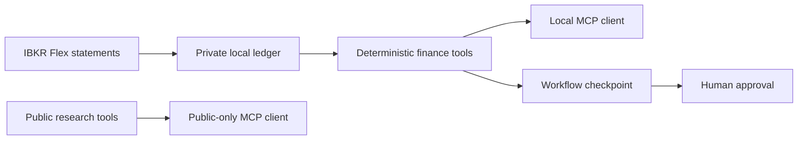

# IBKR Agent Harness

**Give your AI agent financial tools, not your brokerage login.**

Local-first Python and MCP toolkit for Interactive Brokers portfolio research, combining deterministic calculations, investment policy checks, valuation and persistent workflows with human approval.

[Quick start](#quick-start) · [Capabilities](#why-use-it) · [Engineering reference](ENGINEERING.md) · [Contribute](CONTRIBUTING.md)

[](https://github.com/RyanYang053/IBKR-Agent-harness/actions/workflows/ci.yml)
[](LICENSE)

## Quick start

```bash
git clone https://github.com/RyanYang053/IBKR-Agent-harness.git
cd IBKR-Agent-harness
python -m venv .venv
```

Activate with `source .venv/bin/activate` on macOS/Linux or `.venv\Scripts\Activate.ps1` in PowerShell.

```bash
python -m pip install -e '.[dev]'
python scripts/demo.py --output harness-demo.html
```

Open the generated HTML file locally. The report runs the existing synthetic verification script and captures actual results and exit status. It is not an authenticated broker session.

## Why use it?

| Instead of asking an LLM to… | Use the harness for… |
| --- | --- |
| Add up positions and deposits | Flex reconciliation, TWR/XIRR |
| Guess valuation and leverage | Driver DCF, reverse DCF, economic exposure and stress |
| Forget its task | SQLite-backed workflows |
| Share portfolio details with a cloud model | Public-only MCP tool surface |
| Approve its own proposal | Operator-controlled approval |



## Connect an MCP client

For cloud-backed clients, use the public-only server and verify your client configuration. Replace the executable path with your environment's Python interpreter.

```json
{
  "mcpServers": {
    "ibkr-public-research": {
      "command": "/absolute/path/to/.venv/bin/python",
      "args": ["-m", "personal_agent.server", "investment", "--public-only"]
    }
  }
}
```

On Windows use `Scripts/python.exe`. Public-only mode restricts the tool surface; it is not a hardware sandbox and cannot protect data independently pasted into a cloud client.

## Connect your own portfolio

See [engineering reference](ENGINEERING.md) and [implementation](IMPLEMENTATION.md) for Flex configuration, Streamlit, model routing and workflows. Keep account identifiers, statements and tokens private.

```bash
ibkr-agent --help
python scripts/verify.py
```

Beta source checkout. No order submission. Live brokerage, external providers, financial/tax accuracy and deployment require separate validation.

## Verification

```bash
python scripts/verify.py
```

See [engineering reference](ENGINEERING.md) for the preserved previous technical documentation, [launch gates](docs/LAUNCH.md) and [MIT license](LICENSE).

## Related projects

- [Atlas Investment OS](https://github.com/RyanYang053/50agent-invest-system) — Local-first research, valuation, quantitative analysis, risk and governance.
- [IBKR Portfolio Analyzer](https://github.com/RyanYang053/ibkr-portfolio-analyzer) — Local-first desktop analytics for holdings, performance, risk and research.

These are separate projects, not a claimed integrated deployment.

## Contributing

See [CONTRIBUTING.md](CONTRIBUTING.md) and [SECURITY.md](SECURITY.md). If the project is useful, consider starring it or reporting a reproducible improvement.

Research and educational use only; not financial or tax advice.
