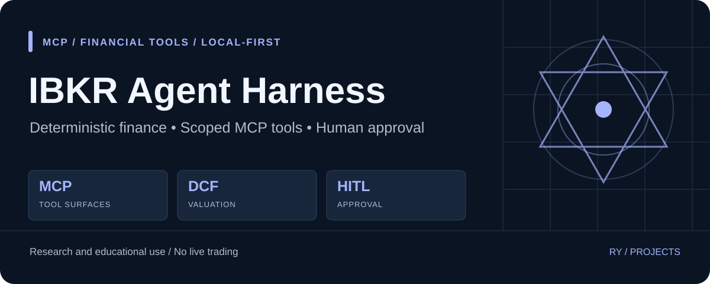
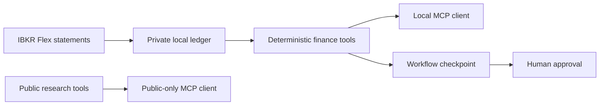

<p align="center">
  
</p>

# IBKR Agent Harness

[English](README.md) · [简体中文](README.zh-CN.md)

**Give your AI agent financial tools, not your brokerage login.**

Local-first Python and MCP toolkit for Interactive Brokers portfolio research, combining deterministic calculations, investment policy checks, valuation and persistent workflows with human approval.

[Try the demo](#try-the-demo) · [Quick start](#quick-start) · [Documentation](#documentation) · [Roadmap](ROADMAP.md) · [FAQ](FAQ.md) · [Contribute](CONTRIBUTING.md)

[](https://github.com/RyanYang053/IBKR-Agent-harness/actions/workflows/ci.yml)
[](LICENSE)

[](https://github.com/RyanYang053/IBKR-Agent-harness/stargazers) [](https://github.com/RyanYang053/IBKR-Agent-harness/forks)
[](https://github.com/RyanYang053/IBKR-Agent-harness/actions/workflows/public-demo.yml) [](https://github.com/RyanYang053/IBKR-Agent-harness/issues) [](CONTRIBUTING.md)

## Try the demo

No personal portfolio, API key or live brokerage session is needed. [Open the public demo workflow](https://github.com/RyanYang053/IBKR-Agent-harness/actions/workflows/public-demo.yml), select a successful run from the branch you want to inspect, download its preview artifact (HTML and PNGs), unzip it and open `harness-demo.html`. GitHub may require sign-in to download an artifact; artifacts expire. The source-checkout commands below work independently of GitHub artifact availability.

The demo is generated from fixture data, not a marketing mock-up, live market quote or financial performance claim.

## Quick start

```bash
git clone https://github.com/RyanYang053/IBKR-Agent-harness.git
cd IBKR-Agent-harness
python -m venv .venv
```

Activate with `source .venv/bin/activate` on macOS/Linux or `.venv\Scripts\Activate.ps1` in PowerShell.

```bash
python -m pip install -e '.[dev]'
python scripts/demo.py --output harness-demo.html
```

Open the generated HTML file locally. The report runs six deterministic checks against the repository's synthetic Flex fixture and illustrative DCF inputs in temporary local state. No live brokerage, model or market-data session is needed.

## Why use it?

| Instead of asking an LLM to… | Use the harness for… |
| --- | --- |
| Add up positions and deposits | Flex reconciliation, TWR/XIRR |
| Guess valuation and leverage | Driver DCF, reverse DCF, economic exposure and stress |
| Forget its task | SQLite-backed workflows |
| Share portfolio details with a cloud model | Public-only MCP tool surface |
| Approve its own proposal | Operator-controlled approval |



## Connect an MCP client

Browse the [MCP tool catalog](docs/MCP_TOOLS.md) for registered operations, visibility and descriptions. The catalog is based on source registrations; verify the actual runtime tool list before connecting a cloud client.

For cloud-backed clients, use the public-only server and verify your client configuration. Replace the executable path with your environment's Python interpreter.

```json
{
  "mcpServers": {
    "ibkr-public-research": {
      "command": "/absolute/path/to/.venv/bin/python",
      "args": ["-m", "personal_agent.server", "investment", "--public-only"]
    }
  }
}
```

On Windows use `Scripts/python.exe`. Public-only mode restricts the tool surface; it is not a hardware sandbox and cannot protect data independently pasted into a cloud client.

## Connect your own portfolio

See [engineering reference](ENGINEERING.md) and [implementation](IMPLEMENTATION.md) for Flex configuration, Streamlit, model routing and workflows. Keep account identifiers, statements and tokens private.

```bash
ibkr-agent --help
python scripts/verify.py
```

Beta source checkout. No order submission. Live brokerage, external providers, financial/tax accuracy and deployment require separate validation.

## Verification

```bash
python scripts/verify.py
```

See [engineering reference](ENGINEERING.md) for the preserved previous technical documentation, [launch gates](docs/LAUNCH.md) and [MIT license](LICENSE).

## Documentation

| Resource | Start here |
| --- | --- |
| First use | [Quick start](#quick-start) |
| Technical detail | [Engineering reference](ENGINEERING.md) · [MCP tool catalog](docs/MCP_TOOLS.md) |
| Frequently asked questions | [FAQ](FAQ.md) |
| Current plans and gaps | [Roadmap](ROADMAP.md) · [Vision](VISION.md) |
| Changes | [Changelog](CHANGELOG.md) |
| Security and privacy | [Security policy](SECURITY.md) |
| Licensing | [MIT license](LICENSE) |
| Contribution process | [Contributing](CONTRIBUTING.md) · [Code of conduct](CODE_OF_CONDUCT.md) · [Support](SUPPORT.md) |
| Releases | [GitHub Releases](https://github.com/RyanYang053/IBKR-Agent-harness/releases) (check current availability) |
| Research reference | [Citation metadata](CITATION.cff) |

## Related projects

- [Atlas Investment OS](https://github.com/RyanYang053/50agent-invest-system) — Local-first research, valuation, quantitative analysis, risk and governance.
- [IBKR Portfolio Analyzer](https://github.com/RyanYang053/ibkr-portfolio-analyzer) — Local-first desktop analytics for holdings, performance, risk and research.

These are separate projects, not a claimed integrated deployment.

## Contributing

See [CONTRIBUTING.md](CONTRIBUTING.md) and [SECURITY.md](SECURITY.md). If the project is useful, consider starring it or reporting a reproducible improvement.

Research and educational use only; not financial or tax advice.
